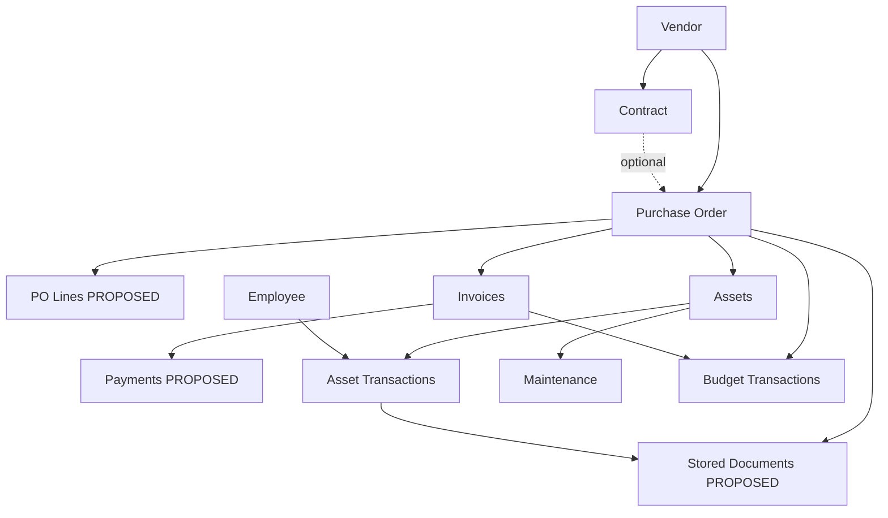

# Domain Workflows — ITDMS (Draft)

**Status:** PROPOSED workflow catalog for backend implementation. Business policies marked **BLOCKED** until decisions in `requirements/reference/DECISION_REGISTER.md` are approved.

## Actors (draft — D01 OPEN)

- **System user:** authenticated principal with scoped permissions (not necessarily an `employees` row).
- **Employee:** HR/inventory subject (`employees` table); may be issuance recipient when D10 allows.
- **Vendor / contract:** procurement context.

## Core scenarios

### WF-01 Register vendor and optional contract

1. Create vendor master (P05).
2. Optionally create contract linked to vendor with dates and value (P07).
3. Attach stored document reference when file policy approved (P14, D13).

**Invariants:** Vendor referenced by future POs; contract independent of PO until linked.

### WF-02 Create purchase order with multiple lines

1. Create PO header: vendor, optional contract, date, currency, status per D03 (P08).
2. Add multiple lines (R15) — line type, qty, unit price PROPOSED.
3. Recompute header total with approved tax/rounding (BLOCKED until finance policy).
4. Approve PO if workflow enabled (BLOCKED D03) → may trigger budget **commitment** (BLOCKED D07).

**Links:** R14 (contract 1:N PO), R15 (lines), R08 (budget side effects later).

### WF-03 Register physical assets from procurement

1. Manually assign **unique** `asset_code` (R03) — never auto-generated without client rule.
2. Link asset to category, optional PO (and optional PO line PROPOSED).
3. Set status/location per D11.

**Conflict:** bulk consumables vs serialized assets (D09) — do not mix models without decision.

### WF-04 Issue assets to holder (employee and/or department)

1. Select one or more assets and recipient (D10).
2. Atomic transaction: validate all assets available; create issuance document header + lines (R17 PROPOSED); append ISSUE rows to `asset_transactions` (R18); update current holder projection.
3. Generate official issue form from org template (R10, D12 BLOCKED for final format).

**Edge cases:** partial issue across multi-asset form; concurrent issue on same asset → 409.

### WF-05 Return assets

1. Identify active issue (by document or asset list).
2. Atomic RETURN transactions; update projection; optional return document (R17, R10).

**Rule:** History rows are never overwritten (R18).

### WF-06 Record invoices and payments on a PO

1. Create one of many invoices for PO (R16).
2. Post invoice / record payments per D05–D06 (BLOCKED for production behavior).
3. Derive outstanding from payment ledger, not mutable status field alone.

### WF-07 Budget encumber, spend, release

1. Define financial year and category allocations (R08).
2. On approved events, append `budget_transactions` (commitment, actual, release, reversal) per D07–D08.
3. Reports reconcile ledger sums (P18) — **no** `allocated - committed - actual` double subtraction.

### WF-08 Maintenance and software renewal

1. Log maintenance against asset and/or contract/vendor (P12).
2. Register license with expiry; renewal workflow (P13, D14 for alerts).

### WF-09 Global search by PO number (PO 360)

1. Normalize PO number (D15).
2. Authorized read model: vendor, contract, lines, invoices, payments, assets, movements, maintenance, licenses, budget links, document metadata (R09).
3. Enforce permission filtering on every section (R11).

## Use-case relationship graph

## Financial questions explicitly deferred (D03–D08)

| Question | Workflow impact |
|---|---|
| PO approval states | WF-02 approve/cancel endpoints |
| When budget commits | WF-02 / WF-07 |
| When actual spend recognized | WF-06 / WF-07 |
| Partial payment math | WF-06 |
| Currency | All money workflows |

## Next implementation mapping

| Workflow | First executable phase | Blockers |
|---|---|---|
| WF-01 | P05–P07 | D15 numbering |
| WF-02 | P08 | D03, D07, D04 |
| WF-03 | P06 | D09, D11 |
| WF-04–05 | P09 | D10, D11, D17 document gen D12 |
| WF-06 | P10 | D05, D06 |
| WF-07 | P11 | D06–D08 |
| WF-08 | P12–P13 | D14, D19 |
| WF-09 | P15 | P04–P14 data exists |
