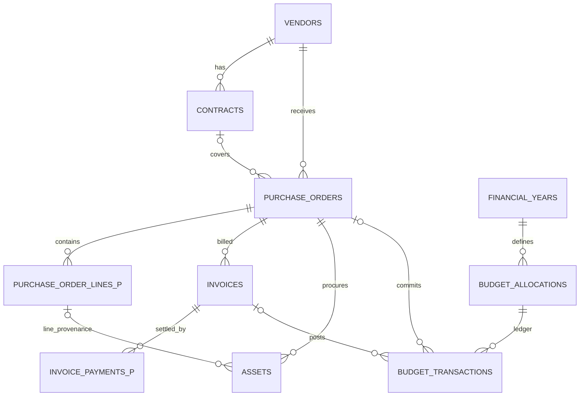
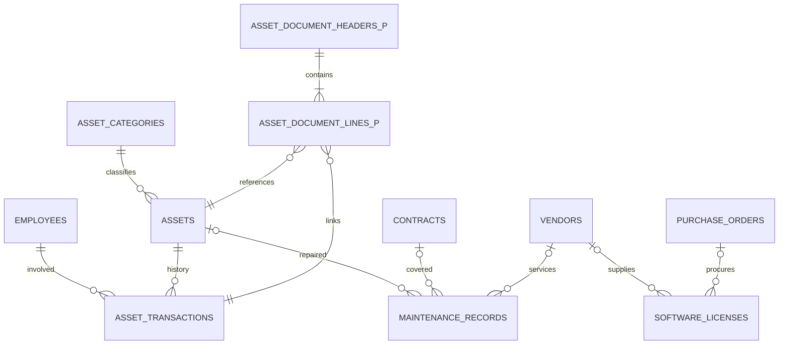
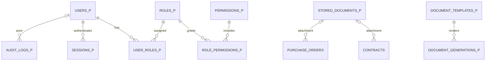

# Entity-Relationship Diagram — Provisional (P00)

Visual companion to `docs/db-schema-proposal.md`. **PROPOSED** entities shown with dashed semantics in legend.

## Legend

- Solid lines: source 13-table relationships (DB traceability).
- `(P)` suffix: PROPOSED extension not in source PDF schema.

## Core procurement and finance

## Inventory, issuance, operations

## Security and documents (PROPOSED)

## Cardinality notes

| Edge | Cardinality | Source |
|---|---|---|
| Contract → PO | 1:N | R14 / DB p4 |
| PO → Invoice | 1:N | R16 |
| PO → Line | 1:N | R15 PROPOSED |
| Asset → Transaction | 1:N | R18 |
| Issue document → Assets | N:M via lines | R17 PROPOSED |

## PO 360 read paths (logical)

For R09 search, authorized joins traverse: `purchase_orders` → `vendors`, `contracts`, `purchase_order_lines`, `invoices`, `invoice_payments`, `assets`, `asset_transactions`, `employees`, `maintenance_records`, `software_licenses`, `budget_transactions`, `stored_documents` — each section permission-filtered.

## Approval gate

ERD must be reconciled with restored PDFs and signed decisions before P02 migration SQL is applied.
