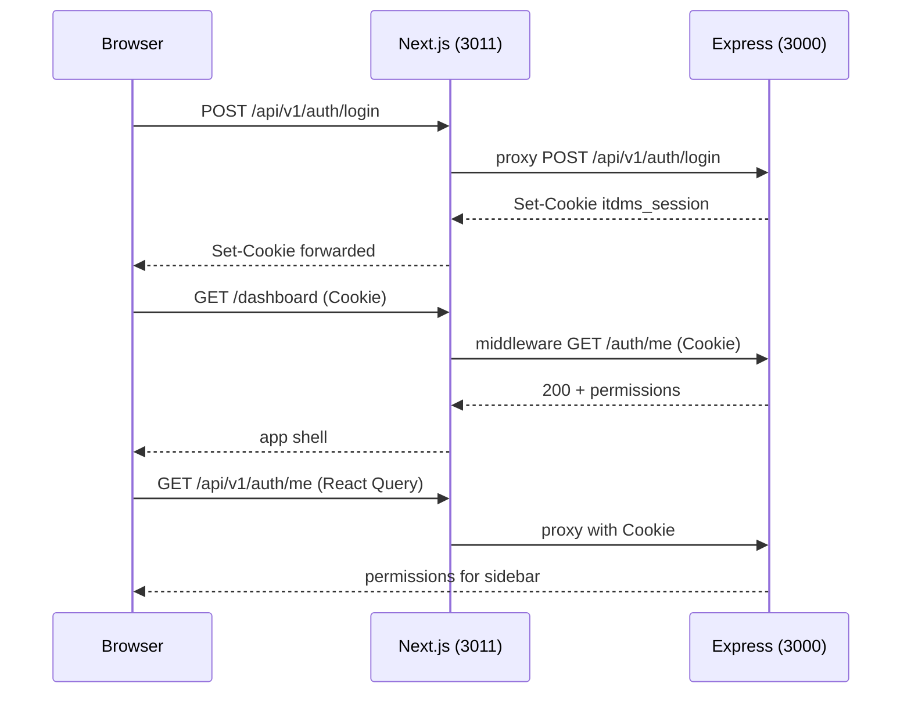

# UI02 — Authentication & API Integration Report

**Status:** **UI02 VERIFIED** (final integration pass)  
**Date:** 2026-11-02  
**Scope:** Real session auth, API client, route protection, permission nav — **no business CRUD (UI03+)**

---

## Auth endpoints integrated (verified against `apps/api` source)

| Action | Method | Path | Body / response |
|---|---|---|---|
| Login | `POST` | `/api/v1/auth/login` | `{ username, password }` → `{ success, data: { userId, username, displayName }, meta }` + **HttpOnly** `Set-Cookie` (`SESSION_COOKIE_NAME`, default `itdms_session`) |
| Logout | `POST` | `/api/v1/auth/logout` | Cookie or `Authorization: Bearer` → `{ loggedOut: true }`, clears cookie |
| Current user | `GET` | `/api/v1/auth/me` | `{ userId, username, displayName, permissions: string[] }` |

**Not used:** CRM JWT, OAuth, refresh tokens. **No CSRF** middleware on Express (session cookie + `SameSite=Lax` only).

---

## Authentication flow



1. User submits login (`react-hook-form` + Zod).
2. `loginRequest` → same-origin `/api/v1/auth/login` → **Route Handler** proxies to Express and forwards `Set-Cookie`.
3. React Query `auth/me` refetch loads permissions.
4. **Middleware** validates session via server-side `GET {ITDMS_API_URL}/api/v1/auth/me` with incoming `Cookie` before rendering protected routes.
5. Logout calls `POST /auth/logout`, clears query cache, redirects to `/login`.

---

## Session & cookie handling

| Rule | Implementation |
|---|---|
| HttpOnly session | Set by Express; not readable from JS |
| No tokens in localStorage | Only `itdms.theme` / `itdms-ui` (UI prefs) |
| Same-origin API | Browser calls `/api/v1/*`; proxy in `src/app/api/v1/[...path]/route.ts` |
| Server middleware | Direct `ITDMS_API_URL` (default `http://localhost:3000`) |
| Expired session | Middleware → `/login?redirect=…&reason=session_expired` |
| Logged-in `/login` | Middleware → `/dashboard` |

Env: `apps/web/.env.example` — `ITDMS_API_URL`, `ITDMS_SESSION_COOKIE_NAME`.

**CORS:** Optional `CORS_ORIGIN` on API; not required when using Next proxy (same origin).

---

## Permission navigation

- `filterNavByPermissions(ITDMS_NAV, user.permissions)` — **no show-all bypass**
- `RouteAccessGuard` — direct URL without permission → access denied UI (not API substitute)
- `UserMenu` — Administration link only if `users.manage`
- Overview `/dashboard` — no permission key (any authenticated user)

D01: permission strings come from DB-backed roles via `/auth/me`, not hardcoded role names.

**Policy blocks (`403 POLICY_NOT_APPROVED`):** UI02 does not call blocked workflows; future UI will use dedicated messaging (distinct from route access denied).

---

## Files created / modified

| Path | Change |
|---|---|
| `src/lib/api/client.ts` | Full `apiFetch` / `apiGet` / `apiPost`, envelope errors |
| `src/lib/api/auth.ts` | login / logout / fetchMe |
| `src/lib/api/server-origin.ts` | Server API origin + cookie name |
| `src/app/api/v1/[...path]/route.ts` | Cookie-aware reverse proxy |
| `src/middleware.ts` | Session gate + login redirect |
| `src/components/providers/AuthProvider.tsx` | Replaces UI01 shell auth |
| `src/app/(auth)/login/page.tsx` | CRM-style `AuthShell` login |
| `src/components/auth/AuthShell.tsx` | Ported from CRM |
| `src/components/shell/AuthenticatedAppShell.tsx` | Loading shell + guards |
| `src/components/shell/RouteAccessGuard.tsx` | Permission check |
| `src/components/shell/AppLoadingShell.tsx` | Prevents content flash |
| `src/config/itdms-navigation.ts` | `findNavItemForPath`, strict filter |
| `src/lib/auth/resolve-auth-me-query.ts` | 401 vs status 0 / 5xx bootstrap mapping |
| `src/lib/auth/middleware-session.ts` | Middleware session validation (no throw on network) |
| `src/components/shell/ServiceUnavailableBanner.tsx` | API-down UI (no protected data) |
| `scripts/smoke-web-auth.mjs` | Live API + optional Next proxy smoke |
| `scripts/smoke-ui02-verification.mjs` | UI02 integration smoke (API + middleware) |
| `scripts/smoke-web-auth-embedded.mjs` | Embedded DB smoke (optional) |
| `tests/auth-me-query.test.ts` | Auth bootstrap + middleware session unit tests |
| `tests/auth-nav.test.ts` | Nav filter + `findNavItemForPath` tests |
| Removed | `ShellAuthProvider.tsx`, `DevShellBanner.tsx` |

---

## API compatibility fixes

**None required.** Express auth matched frontend integration without backend code changes.

---

## Final verification checklist (pre-UI03)

| # | Requirement | Evidence |
|---|---|---|
| 1 | Login, refresh persistence, logout, expired session | Browser (Next `start` on `:3011`): sign-in `admin.dev` → redirect to `/employees`; reload `/employees` keeps shell + nav; Sign out → `/login`; stale cookie `GET /dashboard` → `307` `/login?…&reason=session_expired` (smoke + manual fetch) |
| 2 | Protected routes without auth | `GET /employees` without cookie → `/login?redirect=%2Femployees`; smoke: unauthenticated `/dashboard` → `/login` |
| 3 | Permission sidebar + unauthorized route | Vitest: `filterNavByPermissions` hides `/vendors` when only `employees.read`; `findNavItemForPath` maps `/admin` → `users.manage`. API: `rbac-isolation.test.ts` denies employee create for read-only role. `RouteAccessGuard` uses same nav permissions (direct URL → “Not authorized” UI) |
| 4 | HTTP 401 vs network (status 0) | `mapAuthMeQueryError`: 401 → anonymous; status `0` / ≥500 → `service_unavailable`. Login shows `ServiceUnavailableBanner` (`role="alert"`, “ITDMS API unavailable”) when `serviceUnavailable` or `?reason=api_unavailable` — no app shell data |
| 5 | Next middleware + Express enforcement | Middleware `validateMiddlewareSession` + Express `requireAuth` on protected routes; smoke: anonymous `GET /api/v1/employees` → **401** |
| 6 | Cookies, CSRF, no bypass | HttpOnly `itdms_session` via proxy; no JWT in `localStorage`; no CSRF on API (SameSite=Lax, same-origin proxy). No dev “show all nav” bypass |
| 7 | Regression tests | **12** web vitest tests; smoke adds stale-session redirect; see `UI02_LOGIN_RUNTIME_FIX.md` for login dev-loop tests |
| 8 | CI commands | All **pass** with Postgres on `127.0.0.1:5433` and API on `:3000` (see table below) |
| 9 | CRM design / responsiveness | Unchanged UI01 tokens, `AuthShell`, dashboard shell; placeholder modules only |

---

## Tests & verification results

**Environment:** PostgreSQL Docker `127.0.0.1:5433`, Express `http://localhost:3000`, Next production `http://localhost:3011` with `ITDMS_API_URL=http://localhost:3000`.

| Check | Result |
|---|---|
| `npm run typecheck --workspace=@itdms/web` | **Pass** (2026-11-02) |
| `npm run lint --workspace=@itdms/web` | **Pass** |
| `npm run build --workspace=@itdms/web` | **Pass** (23 static routes + middleware 32.3 kB) |
| `npm run test --workspace=@itdms/web` | **Pass** — **12/12** tests (`auth-me-query`, `auth-nav`) |
| `npm run typecheck --workspace=@itdms/api` | **Pass** |
| `npm run lint --workspace=@itdms/api` | **Pass** |
| `npm run test --workspace=@itdms/api` | **Pass** — **34/34** tests (vitest ~485s) |
| `node scripts/smoke-web-auth.mjs` | **Pass** — API login/me/logout |
| `WEB_ORIGIN=http://localhost:3011 node scripts/smoke-web-auth.mjs` | **Pass** — proxied login **Set-Cookie** present |
| `WEB_ORIGIN=http://localhost:3011 node scripts/smoke-ui02-verification.mjs` | **Pass** — 8 checks including middleware redirect + `session_expired` |
| `node scripts/smoke-web-auth-embedded.mjs` | **Not run** (optional; Windows embedded PG fragile) |

**Smoke output (representative):**

```text
[pass] invalid login -> 401
[pass] valid login -> 200 + Set-Cookie
[pass] session persistence via cookie -> me (29 permissions)
[pass] protected API rejects missing cookie -> 401
[pass] logout revokes session -> me 401
[pass] Next middleware redirects unauthenticated /dashboard -> /login
[pass] stale session cookie -> /login?reason=session_expired
proxied login Set-Cookie present OK
```

**Note:** Do not run `next build` while `next dev` is serving the same app — it can corrupt `.next` and cause 500 / “missing required error components”. Use `next start` after build for verification, or restart dev after build.

---

## Screenshots

| Asset | Status |
|---|---|
| UI01 shell reference | `docs/frontend/screenshots/ui01-*` (unchanged baseline) |
| UI02 login / shell | Verified in browser session 2026-11-02 (`/login` AuthShell, post-login sidebar + overview placeholder) |

Visual design: login uses same `AuthShell` / tokens as CRM; ITDMS copy, no OAuth, decorative panel uses `—` not fake KPIs.

---

## Known limitations

- Middleware + client each call `/auth/me` (acceptable for UI02; optimize later).
- No refresh token — 8h session TTL (`AuthService`); expiry redirects to login.
- Embedded auth smoke script may need a clean `apps/api/data/auth-smoke-db` on some Windows setups.
- `POLICY_NOT_APPROVED` banner component deferred to procurement UI (UI05).
- Next **15.1.3** security advisory unchanged from UI01 (CRM version pin).

---

## UI03 readiness

- Auth + permissions + API client ready for dashboard KPI queries (`GET /notifications/unread-count`, etc.).
- Remove overview empty state when wiring real aggregates.
- Use `apiGet` with `credentials: 'include'`; handle `ApiClientError` for 401/403.

**UI02 VERIFIED — ready for UI03.** UI03 not started (per phase gate).
