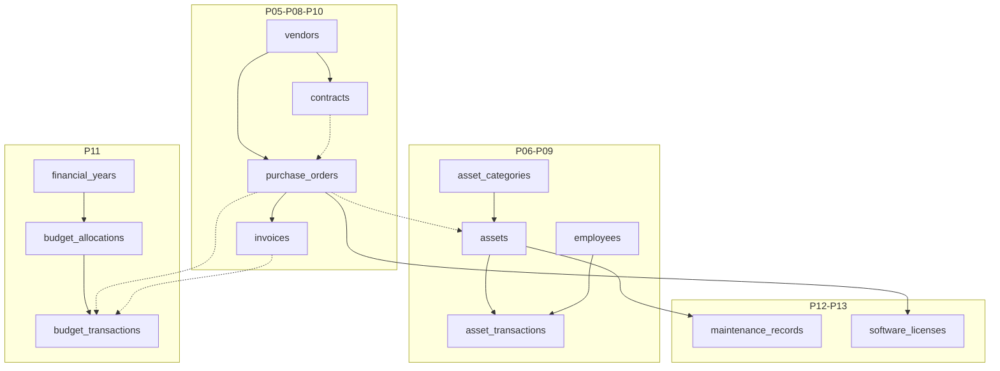

# P02 Readiness Report — Schema & Migrations (Pre-implementation)

**Prepared:** 2026-10-31  
**Phase spec:** `requirements/phases/P02_database_migrations.md`  
**Status:** **READY TO PLAN** — **NOT APPROVED TO MIGRATE** until stakeholder sign-off  
**No migrations executed in this step.**

---

## 1. Purpose

Identify what can be safely translated into Prisma/PostgreSQL in P02 without inventing financial, procurement, issuance, or permission policy—and what must remain blocked until decisions in `requirements/reference/DECISION_REGISTER.md` are approved.

---

## 2. Confirmed source entities (13 baseline tables)

From DB PDF / `docs/db-schema-proposal.md` — **client source**, not yet migrated:

| # | Table | Role in modules |
|---|---|---|
| 1 | `employees` | P04 |
| 2 | `asset_categories` | P06 |
| 3 | `assets` | P06, P09 |
| 4 | `vendors` | P05 |
| 5 | `contracts` | P07 |
| 6 | `purchase_orders` | P08 |
| 7 | `invoices` | P10 |
| 8 | `asset_transactions` | P09 |
| 9 | `maintenance_records` | P12 |
| 10 | `software_licenses` | P13 |
| 11 | `financial_years` | P11 |
| 12 | `budget_allocations` | P11 |
| 13 | `budget_transactions` | P11 |

**Source-confirmed relationships (DB p4 / R14–R18):**

- Vendor → many contracts; vendor → many POs
- Contract → many POs (`purchase_orders.contract_id` **nullable**)
- PO → many invoices
- Asset → many `asset_transactions` (append-only history)
- Financial year → many budget allocations → many budget transactions
- Optional links: PO/invoice on `budget_transactions`; asset → optional PO

---

## 3. Proposed additional tables (NOT in 13-table PDF list)

| Table(s) | Rationale | P02 without approval? |
|---|---|---|
| `purchase_order_lines` | DB p4: multi-line POs (R15) | **Needs explicit approval** — structural but not one of the 13 named tables |
| `users`, `roles`, `permissions`, joins, `sessions` | P03 auth (D01, D02, D22) | **Defer** or skeleton only with draft label |
| `invoice_payments` | Outstanding/partial pay (D05) | **Do not migrate** |
| `asset_document_headers` / `asset_document_lines` | Multi-asset forms (R17, DB p3) | **Defer** until D10 + document workflow approved |
| `stored_documents`, templates, generations | P14 (D12, D13) | **Defer** |
| `audit_logs`, `notification_events` | P17, P16 (D14, D16) | **Defer** or minimal audit stub with approval |
| `departments`, `stock_items`, `stock_movements` | D09, D18 | **Do not migrate** |
| `software_license_assignments`, renewals | Optional | **Defer** |

**Recommended first migration scope** (matches `docs/decision-meeting-packet.md` §4): **13 baseline tables only**, plus engineering columns explicitly marked PROPOSED (e.g. `created_at` / `updated_at`), **not** payment ledger or auth policy tables.

**Separate stakeholder question:** Approve **`purchase_order_lines`** in the same migration as POs (strong source support on DB p4) vs strict “13 tables only” minimalism.

---

## 4. Required constraints (safe defaults — still need sign-off on enums)

| Constraint | Applies to | Notes |
|---|---|---|
| **UNIQUE** | `employee_number`, `asset_code`, `po_number`, `contract_number`, `invoice_number` (scope D15) | Manual asset codes (R03); DB-enforced duplicates rejected |
| **UNIQUE** | `asset_categories.category_name` | Policy choice — document in migration |
| **FK + INDEX** | All PDF FK columns | Index FK columns for join/search (P15 later) |
| **RESTRICT** (no CASCADE delete) | History/finance edges | P02 gate; aligns with D16 direction |
| **CHECK** | Money fields ≥ 0 where business agrees | `numeric(18,2)`; no JS float |
| **CHECK** | Dates (`start_date` ≤ `expiry_date` on contracts) | Service layer may also enforce |

**Do not add without decision:**

- `purchase_orders.expiry_date` (D04)
- Department holder on issuance (D10)
- Payment ledger columns beyond PDF `invoices.payment_status` / `payment_date` semantics (D05)

---

## 5. Module ↔ data relationships (implementation map)

---

## 6. Transaction & financial consistency (schema-level intent)

| Domain | Requirement | Schema implication |
|---|---|---|
| Asset movements | No overwrite (R18) | Append-only `asset_transactions`; no UPDATE of historical movement rows in normal ops |
| Budget | Avoid double counting (R18) | Separate `budget_allocations` vs `budget_transactions`; **do not** encode commit/actual/reversal enums until D07–D08 approved |
| Invoices | Multiple per PO (R16) | 1:N PO→invoices OK in baseline |
| Payments | Outstanding balances (BO) | **Blocked** without `invoice_payments` + D05 |
| PO totals | Multi-line POs (R15) | Needs lines table or denormalized-only PO (latter **conflicts** with source) |
| Concurrency | Issue/return, budget posts | DB transactions + unique constraints (P09/P11 later); P02 lays FK/unique foundation only |

**Do not implement in P02:** triggers or generated columns that **post** budget or payment totals as if policy were approved.

---

## 7. Unresolved stakeholder decisions (migration impact)

| ID | Topic | P02 impact if OPEN |
|---|---|---|
| **D01–D02** | Roles / auth source | Skip auth tables or add **draft** tables not seeded with real roles |
| **D03** | PO lifecycle | `purchase_orders.status` as **varchar** or provisional enum — document only |
| **D04** | PO expiry | **No** expiry column |
| **D05** | Partial payments | **No** `invoice_payments` |
| **D06–D08** | Budget/payment timing, currency | `budget_transactions.transaction_type` **varchar** without business enum; single currency per allocation row only |
| **D09** | Consumables vs serialized | **No** stock tables; `assets` only |
| **D10** | Department issuance | **No** department FK; `employee_id` nullable semantics TBD in services |
| **D11** | Asset status values | Provisional enum or varchar — **label draft** |
| **D15** | Numbering scope | UNIQUE global vs per-year — migration must match approved rule |
| **D16** | Soft delete | Prefer `is_active` / archive flags on masters; RESTRICT on dependents |
| **D18** | Department master | Keep `employees.department` text |

All remain **OPEN** in `DECISION_REGISTER.md` as of audit date.

---

## 8. Safe to implement in P02 (after written baseline approval)

1. Prisma models for **13 PDF tables** with PostgreSQL types (`Decimal`, `DateTime`, `@db.Date`, etc.).
2. Foreign keys and indexes mirroring `docs/db-schema-proposal.md`.
3. Unique constraints on business identifiers listed in §4.
4. First **`prisma migrate`** SQL reviewed manually (no `db push` to prod pattern).
5. Repository **lookup primitives** and migration integration tests per P02 checklist (duplicate asset code, 1 contract→2 POs, 1 PO→2 invoices, multi movement rows).
6. Test seed **fixtures** only — no invented company policy.

---

## 9. Requires stakeholder approval before migrate

| Item | Why |
|---|---|
| Baseline 13-table sign-off row | P00/P02 gate (`decision-meeting-packet.md` §6) |
| Inclusion of **`purchase_order_lines`** | Source-supported but not in “13 tables” list |
| Auth table set | D01/D02 |
| `invoice_payments` | D05 |
| Issuance document header/lines | D10, R17 |
| PO expiry column | D04 |
| Stock/consumables | D09 |
| Enum values for PO status, budget transaction types, asset status | D03, D07, D11 |

---

## 10. P02 verification plan (when implementation starts)

- `prisma migrate dev` on clean DB + additive upgrade test
- Integration tests: FK violations, unique violations, decimal roundtrip, no accidental ON DELETE CASCADE
- Regenerate ERD/DB dictionary from **actual** migration
- Update `IMPLEMENTATION_STATUS.md` with migration name and test output

---

## 11. Gate decision

| Question | Answer |
|---|---|
| Is P01 foundation adequate? | **Yes** (see `P01-foundation-audit.md`) |
| May Cursor run P02 migrations now? | **No** — obtain baseline (and optional PO lines) sign-off first |
| Next action | Stakeholder completes sign-off sheet; then implement P02 per approved scope only |

**Stopped at P02 preparation gate.**
