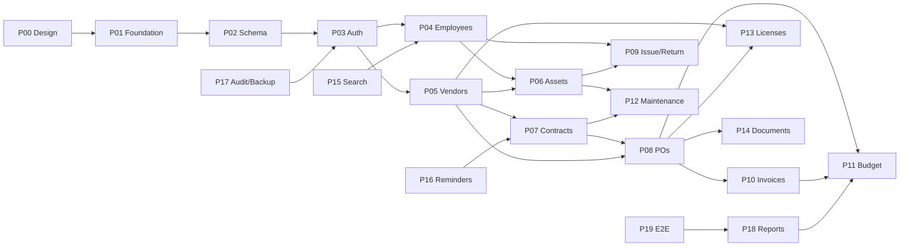

# Requirements Coverage Map (P00)

**Audit date:** 2026-10-28  
**Repository:** `D:\ITDM-Sale-Management`  
**Source hierarchy:** BO → DB → `DECISION_REGISTER.md` (approved only) → this kit (proposed)

## PDF availability

| File | Pages | Verified |
|---|---|---|
| `requirements/Background and Objective.pdf` (BO) | 4 | Yes — read end-to-end 2026-10-28 |
| `requirements/Database structure.pdf` (DB) | 4 | Yes — read end-to-end 2026-10-28 |

Page citations in this kit align with PDF content (modules BO §2; global search BO §3; documents BO §4–5; security BO §6; deployment BO §7–8; 13 tables DB §A–E; design decisions DB p4).

## Requirement IDs R01–R19

| ID | Client capability (paraphrase) | Source (traceability) | Primary phases | Acceptance / test hook |
|---|---|---|---|---|
| R01 | Browser-based internal app; dedicated in-house server; LAN access | BO p1, p3 | P01, P19 | Health + on-prem deploy checklist (P19) |
| R02 | Employee records (dept, contact, assignments) | BO p1; DB p1 | P04 | CRUD + unique employee number |
| R03 | IT inventory: categories, qty/serials/location; **manual unique asset code** | BO p1,p3; DB p1,p4 | P06, P09 | DB unique on `asset_code`; issue/return |
| R04 | Vendors, contracts, POs, values, attachments, dates, renewals/expiry alerts | BO p1; DB p1–2,p4 | P05, P07, P08, P14, P16 | Contract 1:N PO; expiry jobs blocked D04/D14 |
| R05 | Invoices linked to PO/finance; balances; payment status | BO p1; DB p2,p4 | P10, P11 | Partial invoices; payment ledger blocked D05 |
| R06 | Software licenses, renewals; asset repair/maintenance | BO p1; DB p3 | P12, P13 | Expiry list; no raw keys (D21) |
| R07 | Issue/return to employees/departments; movement history; condition/location | BO p1,p3; DB p2–3 | P09 | Append-only transactions; D10 holder model |
| R08 | Annual budget: allocated, committed, actual, utilized, remaining | BO p1; DB p3–4 | P11, P18 | Ledger no double-count; D06–D08 |
| R09 | Unified relational DB; PO-number global linked retrieval | BO p2; DB p1 | P02, P15 | FK integrity; PO 360 search |
| R10 | Org templates: PO, contract, issue/return, invoice, expenditure, budget, asset reports (PDF/Excel) | BO p2–3; DB p4 | P14, P18 | Signed templates required D12 |
| R11 | Authentication, RBAC, financial access control, audit logs | BO p3 | P03, P17 | Default deny; D01/D02 |
| R12 | Regular DB backup and recovery | BO p3 | P17, P19 | Backup/restore drill |
| R13 | Modular, maintainable; dashboard-friendly; backend-first in plan | BO p3–4 | P00–P19 | ADR 0001; module layout |
| R14 | PO and contract separate; 1 contract → many POs | DB p4 | P07, P08 | Nullable `contract_id` on PO |
| R15 | POs contain multiple product/service lines | DB p4 | P08 | `purchase_order_lines` PROPOSED |
| R16 | Multiple / partial invoices per PO | DB p4 | P10 | 1:N PO→invoices |
| R17 | Issuance documents cover multiple assets; header/line design | DB p3 | P09, P14 | Document header/lines PROPOSED |
| R18 | Keep asset transactions; separate budget/financial transactions; avoid double counting | DB p4 | P09, P11 | No overwrite; append-only ledger |
| R19 | Store references to generated documents (controlled templates) | DB p4 | P14 | `stored_documents` PROPOSED |

## Conflicts and gaps (not resolved in P00)

| Topic | BO / operational need | DB baseline | Decision | Blocks |
|---|---|---|---|---|
| Inventory quantity vs serialized assets | Quantity-based stock mentioned | Per-asset unique code | D09 | P06 consumables, stock ledger |
| Issue to department | Employee or department recipient | `asset_transactions.employee_id` only | D10 | P09 schema, issue API |
| PO expiry alerts | Alerts implied | No PO expiry column | D04 | P16 PO reminders |
| Outstanding payments | Balances / status | Status/date only; no payment rows | D05 | P10 posting |
| Budget semantics | Committed / actual / remaining | Generic `transaction_type` | D06–D08 | P11 aggregates |
| Roles | Sensitive financial access | Not in PDF | D01 | P03+ all mutations |

## Phase dependency overview

## Document validation (P00 checklist)

- All phase files `P00`–`P19` present under `requirements/phases/` — verified by script (see phase report).
- Decision register IDs D01–D24 present — verified.
- No HTTP endpoints implemented in P00 — confirmed (repo contains requirements + docs only).

## Stakeholder gate (P00 exit)

- [ ] Add missing PDFs and confirm traceability page numbers.
- [ ] Review provisional schema (`docs/db-schema-proposal.md`, `docs/erd.md`).
- [ ] Assign owners/dates for OPEN decisions in `DECISION_REGISTER.md`.
- [ ] Approve baseline 13-table migration scope for P02 (extensions conditional).
