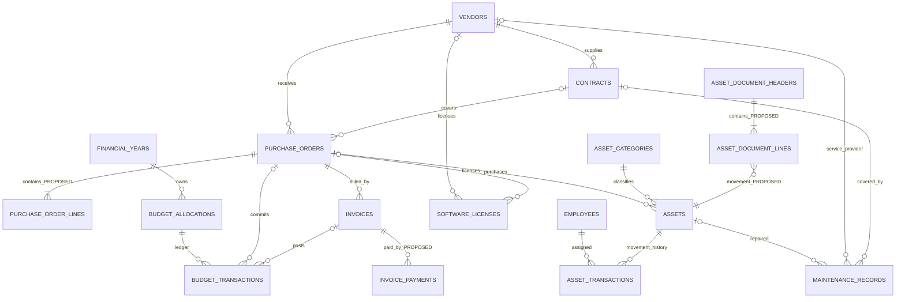

# Relational Data Model Blueprint — Proposed, Not Yet Approved

**Source:** DB pp1–4 defines the initial 13 records and most columns; BO pp1–3 states broader requirements. This document interprets these inputs for a PostgreSQL design. Field additions and all schemas below require P00 decisions.

## 13 source-defined tables (preserve source field semantics)
| Table | Core PDF fields / key relations | Notes |
|---|---|---|
| `employees` | `employee_id` PK, unique `employee_number`, full_name, department, designation, contact_number, email, is_active | Employee is not automatically a login user. |
| `asset_categories` | `category_id`, category_name, description | Define unique category name policy. |
| `assets` | `asset_id`, **manually assigned unique** asset_code, asset_name, category_id FK, serial_number, purchase_order_id optional FK, purchase_date, purchase_cost, asset_status, current_location | Physical asset = distinct row; purchase order line link proposed separately. |
| `vendors` | vendor_id, vendor_name, registration_number, contact_person, phone, email, address | Registration unique only if business approves. |
| `contracts` | contract_id, unique contract_number, vendor_id FK, start_date, expiry_date, contract_value, renewal_status, document_path | 1 vendor many contracts, independently of POs. |
| `purchase_orders` | purchase_order_id, unique po_number, vendor_id FK, optional contract_id FK, po_date, total_amount, currency, status, document_path | 1 contract can cover many POs. PO expiration NOT in initial fields. |
| `invoices` | invoice_id, invoice_number, purchase_order_id FK, invoice_date, invoice_amount, payment_status, payment_date | Multiple invoices per PO. Payment detail missing; extension proposed. |
| `asset_transactions` | transaction_id, asset_id FK, employee_id FK, transaction_type issue/return, transaction_date, condition_notes, reference_number, processed_by, remarks | History append-only; department recipient requires clarification. |
| `maintenance_records` | maintenance_id, optional asset_id / contract_id / vendor_id FKs, maintenance_type, request_date, completion_date, cost, status, remarks | Define whether all references can be null. |
| `software_licenses` | license_id, software_name, secure license_key_reference, optional vendor_id / purchase_order_id FKs, start_date, expiry_date, license_quantity, renewal_cost, status | Never display secrets directly. |
| `financial_years` | financial_year_id, year_name, start_date, end_date, status | Decide overlap policy. |
| `budget_allocations` | budget_id, financial_year_id FK, budget_category, allocated_amount, currency | Multi-currency accounting explicitly unresolved. |
| `budget_transactions` | budget_transaction_id, budget_id FK, optional purchase_order_id / invoice_id FKs, transaction_type, amount, transaction_date, remarks | Source says separate allocation vs transactions and avoid double counting. |

## Candidate extra tables — PROPOSED
- AuthN/RBAC: `users`, `roles`, `permissions`, `user_roles`, `role_permissions`, `sessions`, possibly `password_reset_tokens` and `login_attempts`. Exact design depends on D01/D02/D22.
- Procurement: `purchase_order_lines` with line type `ASSET|SERVICE|SOFTWARE|OTHER`, quantity, unit price, currency or order currency, tax/discount policy (unknown), computed line subtotal. Check linkage to `assets.purchase_order_id` as source baseline; optional `purchase_order_line_id` for provenance.
- Finance: `invoice_payments` or payment ledger, credit/reversal entries if approved, optional `invoice_lines`/PO-line allocations if needed. Prevent double counting and do not create monetary operations ahead of D05–D08.
- Issuance: `asset_document_headers` and `asset_document_lines` so one form covers many assets; lines link source `asset_transactions` and document ID. Return pairing or active issue representation must be reviewed.
- Documents: `stored_documents`, `document_templates`, `document_generations` for controlled private file paths, hashes and revisions.
- Operations: `audit_logs`, `notification_events` / `notification_delivery_attempts` for deduplicated alerts.
- Conditional: `departments`, `locations`, `stock_items`/`stock_movements`, `software_license_assignments`, `contract_renewals` only after approved need.

## Relationship diagram (conceptual; do not run as SQL migrations)

## Constraint and SQL design checklist
- Prefer UUID or bigint PK consistently; external `employee_number`, `asset_code`, `po_number`, `contract_number` remain distinct business identifiers.
- Case/whitespace canonicalization before unique `asset_code`, `po_number` etc. Decide storage and display casing; enforce database uniqueness (not only API check).
- Use PostgreSQL `numeric(18,2)` or approved scale for money; never JS floating point for finance, decide rounding explicitly.
- FK indexes, unique keys, check constraints (nonnegative quantities, appropriate amounts, dates), timestamps with timezone, UTC storage and business timezone conversion.
- Do not cascade-delete transactions, invoices, or referenced assets; define policy before migration. Consider optimistic concurrency (`version`) where appropriate.
- DB transactions around inventory assign/return, PO state changes, invoice posting/payment, budget updates; guards against parallel requests.
- Do not use hard-coded user roles or unapproved finance enums as client requirements.
- Set nullable as source indicates, but validate semantic rules through services.
- Make migrations additive, review destructive operations, test with seeded realistic fixtures; never automatic `db push` in production.

## Unresolved modeling fault lines
1. BO mentions asset **quantities**, while DB assigns code per physical item → serialized assets vs bulk consumables (D09).
2. BO says issue to employee **or department**, DB transaction only has employee FK (D10).
3. BO requires PO expiry alerts, DB purchase_orders has no expiry (D04).
4. BO requires outstanding payments, DB `invoices` has status/date but not payment ledger (D05).
5. BO wants invoice links to contracts/vendors/budgets, DB routes via PO and budget_transactions; design joins, avoid inconsistent copied IDs.
6. BO has committed/actual/remaining budgets, DB generic transaction_type; accounting policy (D06–D08).
7. DB notes multi-line PO and issue forms but does not provide columns — propose and approve in P00.
